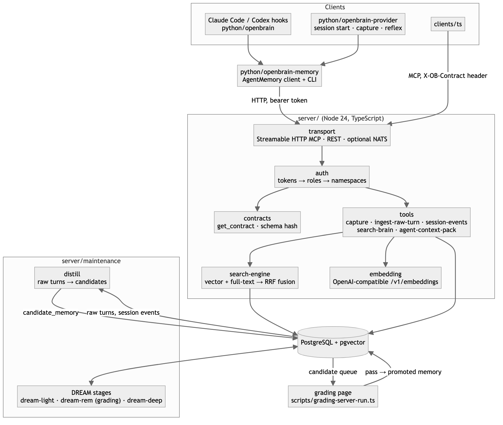

# Open Brain

Shared, scoped long-term memory for AI agents, served as an MCP server over
PostgreSQL and pgvector.

[](LICENSE)




*Architecture of the actual components. Open Brain has no hosted UI to
screenshot; the local grading page needs a live database.*

## What it is

Open Brain stores what AI agents learn (thoughts, decisions, session events,
repo facts, contacts) in PostgreSQL with pgvector, and serves it back through
versioned MCP tools with hybrid retrieval: vector similarity plus full-text
search, fused with reciprocal rank fusion (RRF). Claude Code and Codex
session hooks capture work as it happens, and a typed Python client and a
TypeScript client talk to the same contract.

## Why it exists

Coding agents forget everything between sessions. When several agents work
for one person, each one also relearns what the others already found. Open
Brain is the one place those agents write to and read from, with three
properties a plain vector store does not give you:

- **Scope and identity.** Every caller has a bearer token mapped to a role
  (admin, agent, readonly, promoter, and others). Memory lives in namespaces,
  and a context pack only returns items whose agent, platform, channel and
  session scope match exactly.
- **A contract, not a tool list.** `get_contract` publishes the tool surface,
  input schemas and a schema hash. Clients declare the contract they were
  built against instead of hard-coding tool names.
- **Nothing becomes durable on its own.** Captured conversation turns are
  distilled into candidates. A candidate becomes memory only after it is
  graded, by a person on the grading page (`docs/grading-page.md`) or by an
  explicit promotion rule.

## How it works

See the diagram above. Session hooks in `python/openbrain` and
`python/openbrain-provider` send events through `python/openbrain-memory`,
the only Python write path, to the server over HTTP with a bearer token. The
server (`server/`) authenticates the token, resolves the namespace, and runs
the requested tool: capture, raw-turn ingest, session events, search or an
agent context pack. Search combines a pgvector similarity query with
PostgreSQL full-text search and fuses the two rankings with RRF. Background
jobs in `server/maintenance` distill raw turns into `candidate_memory` and
run the DREAM stages (light, REM grading, deep), and the grading page is
where a person promotes or rejects each candidate.

## Features

- MCP server over Streamable HTTP, with a REST surface and an optional NATS
  request/reply transport.
- Hybrid retrieval: vector plus full-text search fused with RRF, and a
  budgeted context-pack builder for session start.
- Role-based access per bearer token, with namespace and scope isolation.
- A published, hashed contract (`get_contract`) and recorded fixtures in
  `contracts/` that pin it.
- Session capture hooks for Claude Code and Codex, with a local spool so a
  network failure does not lose a turn.
- Distillation of raw turns into candidates, and a keyboard-driven grading
  page to promote or reject them.
- Ordered SQL migrations, backup and restore scripts with verification, and
  retrieval evaluations in `eval/`.
- Example Kustomize manifests in `k8s/` (registry and hostnames are
  placeholders).

| Path | What it is |
|---|---|
| `server/` | The MCP server (Node 24, TypeScript, `pg`, pgvector). |
| `server/db/migrations/` | The schema, as ordered SQL migrations. |
| `scripts/` | Migration runner, backfill, curation, distillation and DREAM stages, backup and restore, the grading server. |
| `python/openbrain-memory` | Python client library and CLI (`openbrain-memory`). |
| `python/openbrain` | Session-capture hooks for Claude Code and Codex. |
| `python/openbrain-provider` | Context-budget and policy gates used by those hooks. |
| `clients/ts` | TypeScript client. |
| `contracts/` | Recorded request/response fixtures that pin the public contract. |
| `eval/` | Retrieval and context-pack evaluations. |
| `skill/` | An agent skill that teaches a model how to use the tools. |
| `docs/` | Architecture, configuration reference, contracts and design notes. |

## Quick start

Requirements: Node.js 24, PostgreSQL 13 or later with the `vector`
extension, and an OpenAI-compatible `/v1/embeddings` endpoint (768
dimensions by default).

```bash
git clone https://github.com/rodaddy/open-brain.git
cd open-brain
npm ci
cp .env.example .env          # fill in DB_*, EMBEDDING_* and AUTH_TOKEN_* values
psql -c 'CREATE EXTENSION IF NOT EXISTS vector;'   # once, against your database
npm run migrate
npm start                     # serves MCP on PORT (default 3100)
```

Generate each auth token with `openssl rand -hex 32`. Every environment
variable and the client configuration are in `docs/README.md` and
`docs/CONFIG_REFERENCE.md`.

Tests:

```bash
npm test                      # unit tests; database suites fail fast without one
npm run test:isolated         # whole suite against a fresh, throwaway database
cd python/openbrain-memory && uv run pytest
```

Suites named `*.pg.test.ts`, `*.live.test.ts` and a few script tests need a
real Postgres (`OPENBRAIN_TEST_DATABASE_URL`); `npm run test:isolated`
creates one, migrates it, runs everything and drops it.

The repo is MIT licensed: use it, change it and ship it, keeping the
copyright notice.

## Project status

Active, single-operator deployment.

- **In daily use by one operator.** The server, the Python client and the
  Claude Code and Codex capture hooks run every day on one person's machines
  and home lab, for a handful of agents. It has not been run multi-tenant or
  at scale.
- **Built and tested, lightly used:** the NATS transport, the DREAM stages,
  the grading page, and the backup and restore drills.
- **Design only:** several documents under `docs/` describe designs that are
  not built. Each says so in its status line.
- Paths such as `/srv/dev` and hostnames such as `*.example.internal` in docs
  and tests are placeholders.
- There is no CI configuration in this snapshot; the original ran on
  self-hosted runners that are not part of this repo.

What it does not do: it is not a hosted service, it does not decide what is
worth remembering for you (capture is broad, promotion is deliberate), and it
does not ship an embedding model.

## Credits

Ideas, not code, from prior memory systems; each is recorded with what was
taken and why in `docs/prior-art/ATTRIBUTION.md`:

- [Graphiti](https://github.com/getzep/graphiti) for the bi-temporal fact
  model.
- [Cognee](https://github.com/topoteretes/cognee),
  [mem0](https://github.com/mem0ai/mem0), Honcho and GBrain, reviewed in
  `docs/prior-art/`.
- [pgvector](https://github.com/pgvector/pgvector) and the
  [Model Context Protocol](https://modelcontextprotocol.io).

## Author

Rico Rojas, https://rico-rojas.com

Licensed under the MIT License. See [LICENSE](LICENSE).
